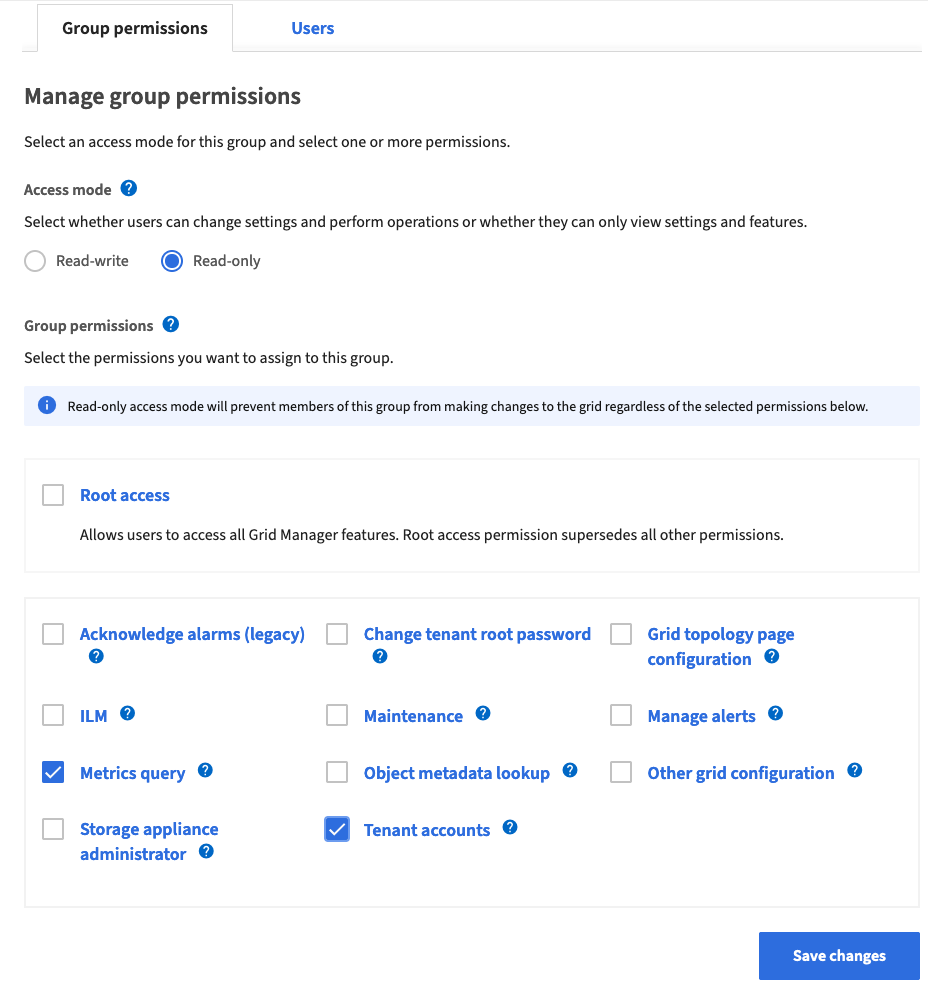
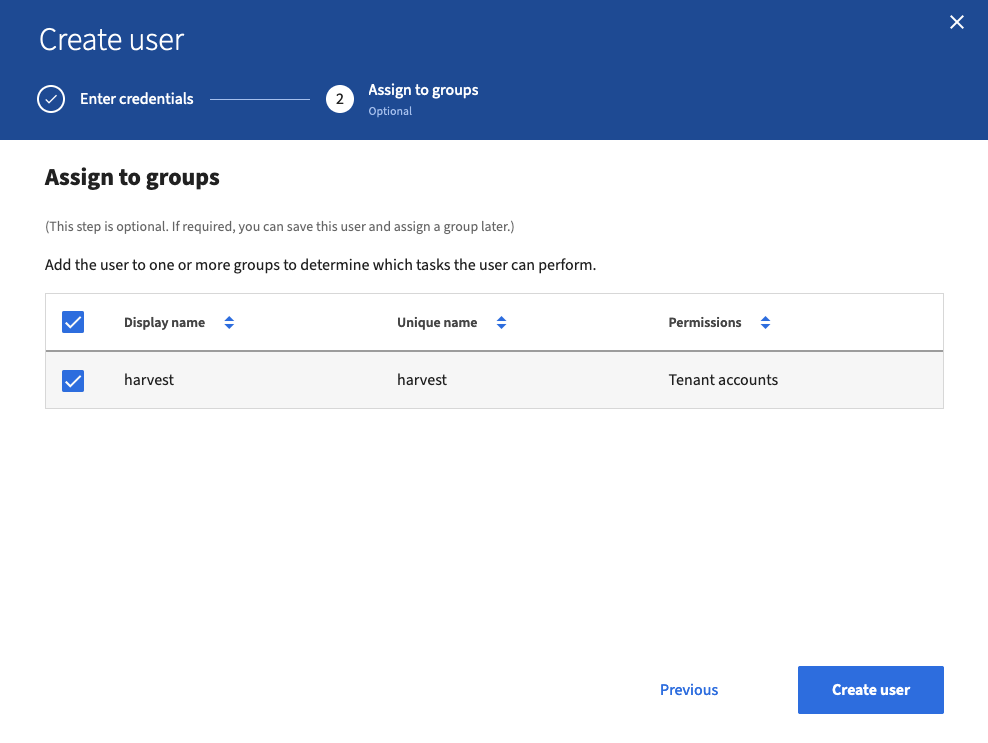

## Prepare StorageGRID cluster

NetApp Harvest requires login credentials to access StorageGRID hosts. Although, a generic admin account can be used, it
is better to create a dedicated monitoring user with the fewest permissions.

Here's a summary of what we're going to do

1. Create a StorageGRID group with the necessary capabilities that Harvest will use to auth and collect data
2. Create a user assigned to the group created in step #1.

## Create StorageGRID group permissions

These steps are
documented [here](https://docs.netapp.com/us-en/storagegrid-116/admin/managing-admin-groups.html#create-an-admin-group).

You will need a root or admin account to create a new group permission.

1. Select CONFIGURATION > Access control > Admin groups
2. Select `Create group`
3. Select `Local group`
4. Enter a display name for the group, which you can update later as required. For example, `Harvest` or `monitoring`.
5. Enter a unique name for the group, which you cannot update later.
6. Select `Continue`
7. On the `Manage group permissions` screen, select the permissions you want. At a minimum, Harvest requires
   the `Tenant accounts` and `Metrics query` permissions.
8. Select `Save changes`

## Create a StorageGRID user

These steps are documented [here](https://docs.netapp.com/us-en/storagegrid-116/admin/managing-users.html).

You will need a root or admin account to create a new user.

1. Select CONFIGURATION > Access control > Admin users
2. Select `Create user`
3. Enter the user’s full name, a unique username, and a password.
4. Select `Continue`.
5. Assign the user to the previously created `harvest` group.
6. Select Create user and select Finish.

!!! note "Changing the Harvest user's credentials"

    StorageGRID keeps accepting an issued token for up to 16 hours ([token lifetime](https://docs.netapp.com/us-en/storagegrid/admin/grid-management-api-operations.html)).
    Changes to a user, including a new password, only take effect when the user signs in again ([Manage users](https://docs.netapp.com/us-en/storagegrid/admin/managing-users.html)).
    In testing, tokens also kept working after the user was deleted ([#4542](https://github.com/NetApp/harvest/issues/4542)).

    Harvest continues collecting after a credential change, and only fails authentication when the token expires, up to 16 hours later.
    Restart the poller after changing its StorageGRID credentials, both to confirm the new credentials work and to stop using the old token.

## Reference

See [group permissions](https://docs.netapp.com/us-en/storagegrid-116/admin/managing-admin-groups.html#group-permissions)
for more information on StorageGRID permissions.